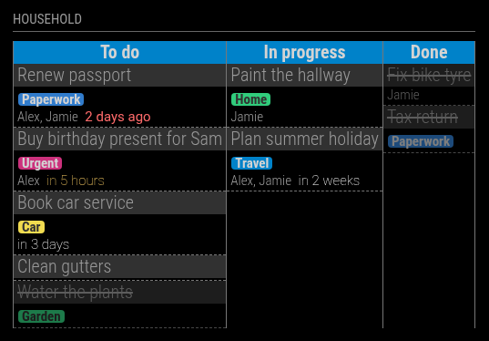
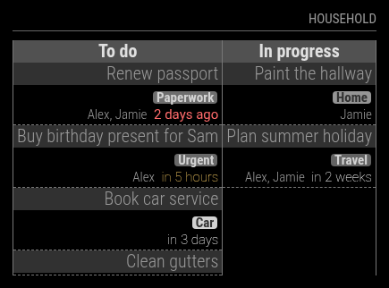
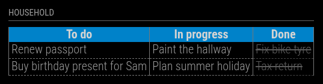

# MMM_ncdeck

A [MagicMirror²](https://magicmirror.builders/) module that shows a board of the
[Nextcloud Deck](https://apps.nextcloud.com/apps/deck) app: one column per stack, cards with
labels, assigned people and due dates.



## Features

* Stacks as columns, cards in Deck order, the board name as module header
* Labels in their Deck colors (or gray), assigned people, due dates like "in 3 days"
* Overdue cards in red, cards due within 24 hours in yellow
* Hide stacks by name, hide cards marked as done, limit the number of cards per stack
* Compact "titles only" layout
* Keeps showing the last data when Nextcloud is unreachable, with a small "Last update" note
* Your Nextcloud password stays on the server (see [Security](#security))
* No dependencies to install

| Detailed, gray labels, "Done" stack and done cards hidden | Simple layout, two cards per stack |
| --- | --- |
|  |  |

## Requirements

* MagicMirror² **2.38 or newer** (older versions may hand your password to the browser, see
  [Security](#security))
* Nextcloud with the Deck app
* A Nextcloud **app password** for the account the mirror uses

## Installation

```sh
cd ~/MagicMirror/modules
git clone https://github.com/motey/MMM_ncdeck.git
```

No `npm install` needed. To update later: `git pull` in the module folder and restart MagicMirror.

## Configuration

### 1. Create an app password

In Nextcloud open **Settings > Security > Devices & sessions**, enter a name like "MagicMirror"
and click **Create new app password**. Use this instead of your login password: you can revoke it
at any time, and it works with two-factor authentication.

### 2. Put the password into `config/config.env`

MagicMirror reads `config/config.env` (next to `config.js`) at start. Variables whose name starts
with `SECRET_` are never sent to browsers:

```sh
# config/config.env
SECRET_NEXTCLOUD_PASS=xxxxx-xxxxx-xxxxx-xxxxx-xxxxx
```

### 3. Add the module to `config/config.js`

```js
{
	module: "MMM_ncdeck",
	position: "bottom_right",
	config: {
		nextcloud: {
			host: "https://cloud.example.org",
			user: "alex",
			pass: "${SECRET_NEXTCLOUD_PASS}"
		},
		deckBoardId: 5,
		hideStacks: ["Done"],
		hideDoneCards: true
	}
},
```

**Board ID:** open the board in Nextcloud. The number at the end of the address is the ID, e.g.
`https://cloud.example.org/apps/deck/board/5` is board `5`.

### Options

| Option | Default | Description |
| --- | --- | --- |
| `nextcloud.host` | `"http://127.0.0.1"` | Base address of your Nextcloud, including a sub path if there is one (`"https://example.org/nextcloud"`). |
| `nextcloud.user` | `""` | Nextcloud user name. |
| `nextcloud.pass` | `""` | App password. Always use `"${SECRET_...}"` here, see above. |
| `deckBoardId` | `null` | ID of the board to show (required). |
| `updateIntervalSec` | `120` | Seconds between updates (at least 30). |
| `hideStacks` | `[]` | Stack titles not to show, e.g. `["Done", "Backlog"]`. |
| `hideDoneCards` | `false` | Hide cards marked as done in Deck. |
| `maxCardsPerStack` | `null` | Show at most this many cards per stack. `null` shows all. |
| `coloredHeader` | `true` | Color the stack header row in the board color. |
| `simpleLayout` | `false` | Show card titles only. |
| `highlightDueCards` | `true` | Overdue due dates in red, due within 24 hours in yellow. |
| `complexLayout.showLabels` | `true` | Show labels on cards. |
| `complexLayout.coloredLabels` | `true` | Labels in their Deck colors. `false` shows them in gray. |
| `complexLayout.showAssignedUser` | `true` | Show the people assigned to a card. |

The `complexLayout` options apply when `simpleLayout` is `false`. You can set only some of them,
the others keep their defaults. A `header` in the module entry replaces the board name as title.

Several instances are fine, also of the same board with different filters. The module asks
Nextcloud once per board, no matter how many instances or browsers show it.

## Styling

Colors are CSS variables. Override them in `config/custom.css`:

```css
.MMM_ncdeck {
  --ncdeck-line: #777;              /* column and card separators */
  --ncdeck-header-bg: #515151;      /* header row when coloredHeader is false */
  --ncdeck-header-fg: #e0e0e0;
  --ncdeck-card-title-bg: #313131;
  --ncdeck-label-bg: #808080;       /* labels without a color */
  --ncdeck-due-soon: #ffd166;
  --ncdeck-due-overdue: #ff6b6b;
}
```

The main classes are `ncdeck-board`, `ncdeck-stack-header`, `ncdeck-stack`, `ncdeck-card`,
`ncdeck-card-title`, `ncdeck-label`, `ncdeck-user`, `ncdeck-duetime` and `ncdeck-status`.

## Security

Only the MagicMirror server talks to Nextcloud. Browsers showing the mirror receive the board
data, never the password:

* With `pass: "${SECRET_...}"` the browser only sees a placeholder. The module warns in the
  MagicMirror log if the password would reach browsers in plain text.
* Host, user, password and board ID are taken from the server's `config.js` only. A browser (or
  any other device that can reach the MagicMirror port) cannot make the server send the
  password somewhere else.
* Card and label texts are shown as plain text, so a card title cannot inject code into the
  mirror page.
* Requests are not redirected: if Nextcloud answers with a redirect, the module reports it
  instead of sending the password to the new address.

Other modules may be less careful with credentials. If you reuse the same `SECRET_...` value in
other modules, check how they handle it, or give the mirror its own Nextcloud user that can only
read what the mirror shows.

## Troubleshooting

Errors show up on the mirror and in the MagicMirror log (lines with `[MMM_ncdeck]`).

| Message | Fix |
| --- | --- |
| `Login failed (HTTP 401)` | Check `nextcloud.user` and the app password. |
| `No access to board N (HTTP 403)` | Share the board with that user in Deck. |
| `Board N not found (HTTP 404)` | Check `deckBoardId`, and that the Deck app is enabled. |
| `Nextcloud redirects to ...` | Use the address from the message as `nextcloud.host` (often `http` vs `https` or a missing sub path). |
| `the variable for nextcloud.pass is not set` | Add the `SECRET_...` variable to `config/config.env` and restart MagicMirror. |
| `No answer from the MagicMirror server for this board` | Restart MagicMirror after changing `config.js`; see the log. |

## Development

The module has no runtime dependencies. Linting and tests need Node.js 20 or newer:

```sh
npm install
npm run check      # eslint + node --test
```

Without a local Node.js, `scripts/dev.sh` runs npm inside the MagicMirror Docker image:

```sh
scripts/dev.sh install
scripts/dev.sh run check
```

Layout of the code:

* `MMM_ncdeck.js`: browser part, renders the board
* `node_helper.js`: connects MagicMirror with `lib/service.js`
* `lib/service.js`: reads the server config, polls Nextcloud, sends data to browsers
* `lib/deck-api.js`: Deck REST client, keeps only the fields the mirror shows
* `lib/shared.js`: helpers used by browser and server (filters, colors, due dates)

## License

MIT, see [LICENSE](LICENSE).
